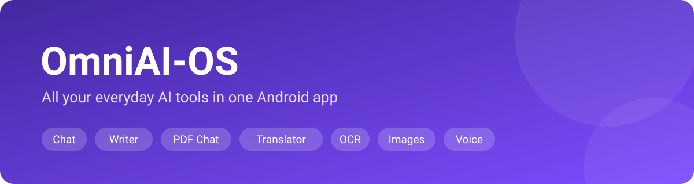
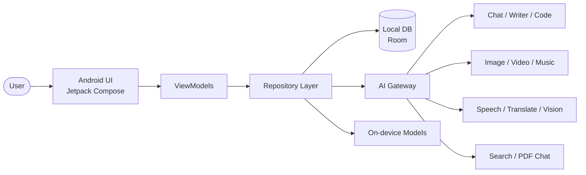
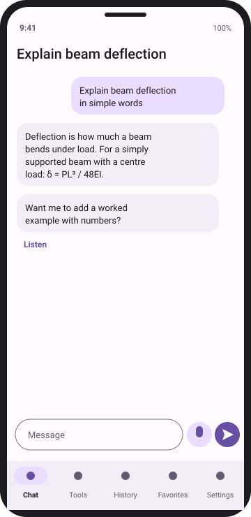
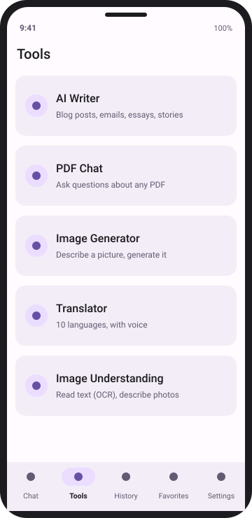
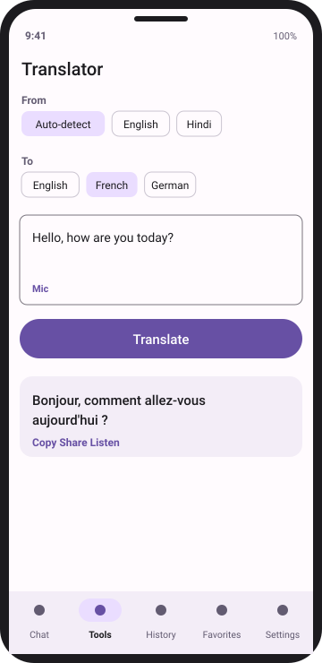
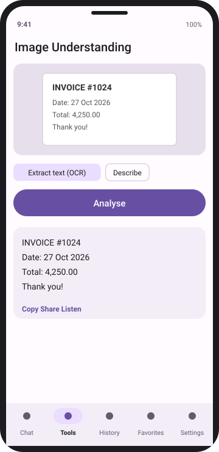
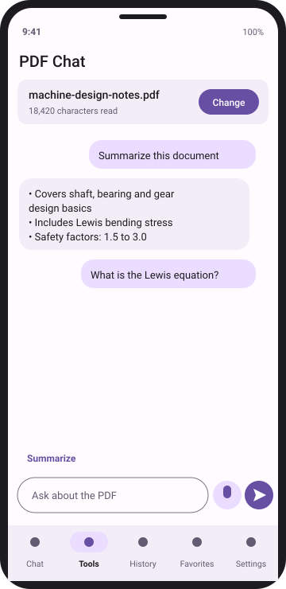
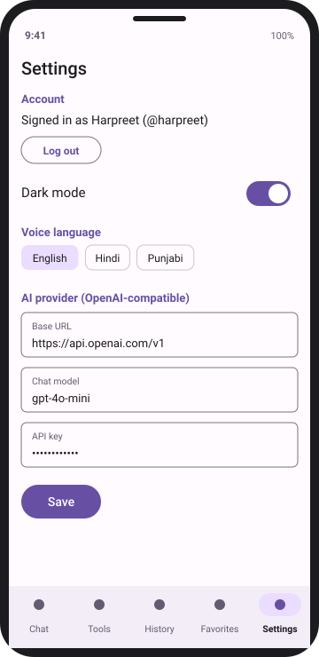

# 🤖 OmniAI-OS

<p align="center">
  
</p>

OmniAI-OS is an AI-powered Android application that brings multiple AI tools and services together in one unified platform.


## ✨ Features

### Core AI tools
- 💬 AI Chat
- ✍️ AI Writer
- 🎨 AI Image Generator
- 🎬 AI Video Generator
- 🎵 AI Music Generator
- 🌐 AI Translator
- 📄 PDF Chat
- 💻 AI Code Assistant
- 🎙️ Speech-to-Text
- 🔊 Text-to-Speech

### Account & personalization
- 👤 User Accounts
- 🌙 Dark Mode
- ⭐ Favorites
- 🕘 Chat & Activity History

### 🆕 New features
- 🔍 **AI Web Search** – answers with sources
- 📷 **Image Understanding (Vision)** – describe, extract text (OCR), solve from a photo
- 📝 **Smart Summarizer** – summarize articles, PDFs, YouTube links and long chats
- 🧠 **Memory & Custom Personas** – remember preferences; create your own assistants
- 🗂️ **Folders, Tags & Global Search** – organize and find any past chat or generation
- 📡 **Offline Mode** – on-device models for basic chat and translation
- 🔐 **App Lock & Privacy Controls** – biometric/PIN lock, export or delete all data
- 🌍 **Multilingual UI** – English, Hindi, Punjabi and more
- 🗣️ **Voice Assistant Mode** – hands-free, continuous conversation
- 🧩 **Prompt Library & Templates** – ready prompts for study, coding, business, social media
- 📤 **Export & Share** – PDF / DOCX / Markdown export, share to any app
- 🎓 **Study Tools** – flashcards, quizzes and notes from any text or PDF
- 📊 **Usage Dashboard** – usage per tool, token/credit tracking
- 🔔 **Reminders & Daily Briefing** – AI-generated daily summary and task reminders
- 🧮 **Document Scanner** – scan, clean up and chat with paper documents
- 🔌 **Model Selector** – switch between AI providers/models per task

## 🗺️ Architecture (planned)



## 🎯 Vision

A single, convenient Android workspace for everyday AI tasks instead of many separate apps.

## 🛠️ Development

- **Platform:** Android (Kotlin, Jetpack Compose, Material 3)
- **Status:** 🚧 Under active development
- **Package:** `com.harpreet.omniai` · min SDK 24

### Run it
1. Open the folder in **Android Studio** (Koala or newer) and let Gradle sync.
2. Press ▶ Run on an emulator or phone.
3. Chat works immediately in **demo mode**. For real AI answers, open **Settings** and enter an OpenAI-compatible Base URL, model and API key (stored only on the device).

### Working tools
| Tool | How it works |
|---|---|
| ✍️ **AI Writer** | Choose type (blog, email, essay…), tone and length → generate → copy / share / listen |
| 📄 **PDF Chat** | Pick a PDF, text is extracted on-device (PdfBox), then ask questions or tap *Summarize*. First ~15,000 characters are used; scanned PDFs are not supported yet |
| 🎙️ **Speech-to-Text** | 🎤 button in Chat, Writer, PDF Chat and Image prompts (uses the phone's speech recognizer) |
| 🔊 **Text-to-Speech** | 🔊 Listen on any AI reply or written text; language chosen in Settings (English / Hindi / Punjabi, if the voice is installed) |
| 🌐 **Translator** | 10 languages (English, Hindi, Punjabi, Urdu, Spanish, French, German, Arabic, Japanese, Chinese), auto-detect source, swap, speak input, listen to the result |
| 🔍 **Image Understanding / OCR** | Pick a photo, then *Extract text (OCR)*, *Describe*, or *Ask a question*. Uses a vision-capable model (e.g. `gpt-4o-mini`), so it also reads Hindi / Punjabi text |
| 👤 **User Accounts** | Sign up / sign in / log out / delete account, guest mode. Each account has its own chat history. Passwords are salted + PBKDF2-hashed. **Local only**: no cloud sync and no password recovery |
| 📝 **Summarizer** | Paste text or reuse the loaded PDF; choose *Bullet points*, *Short paragraph*, *Detailed* or *Explain simply* |
| 🎓 **Study Tools** | Turn any text into flashcards (tap to flip) or a multiple-choice quiz with score and explanations. Needs an API key |
| 🧩 **Prompt Library** | 15 ready prompts (Study, Coding, Business, Social, Engineering) that open straight in Chat |
| 🧠 **Personas** | Built-in Teacher, Coder, Mechanical Engineer, Career Coach, Punjabi Helper, plus your own custom assistants. Switch from the top of Chat |
| 🔎 **Search & Export** | Search across all chat titles and messages in History; share any chat as Markdown text |
| 🔒 **App Lock** | Optional 4–6 digit PIN (salted PBKDF2 hash); re-locks after 30 s in the background |
| 📊 **Usage Dashboard** | Counts of chats, messages, tool uses and approximate tokens (Settings) |
| 💻 **Code Assistant** | Explain, debug, write, review, generate tests for or convert code between 12 languages; copy or share the result |
| 🔌 **Model Selector** | Keep a list of saved models and switch between them with one tap in Chat or Settings |
| 👆 **Biometric unlock** | Optional fingerprint / face unlock on top of the PIN (PIN stays as fallback) |
| 📤 **Data export** | Save all chats and custom personas as a JSON file, or share them as Markdown. The API key is never exported |
| 🌍 **Multilingual UI** | App language: English, हिन्दी, ਪੰਜਾਬੀ (main screens, tools menu, settings and lock screen) |
| 🔎 **Web Search** | Ask a question, the app searches the web through **your own Tavily or Brave Search API key** (Settings) and answers with numbered, tappable sources |
| 🗒️ **Memory** | Save facts about yourself (stored locally, per account); they are added to every chat as context. Can be switched off and is included in data export |
| 📴 **Offline mode** | Chat with an on-device model (MediaPipe LLM Inference, e.g. a Gemma model file you download and pick in Settings) and translate offline with ML Kit (language packs download once; Punjabi and Auto-detect are not available offline). Web search, image tools and OCR still need internet |
| 📷 **Document Scanner** | Google ML Kit scanner (edge detection, crop, filters, multi-page) → save as PDF, extract text with your vision model, then chat with the scan via PDF Chat |
| 🎨 **Image Generator** | Any OpenAI-compatible `/images/generations` endpoint; save to *Pictures/OmniAI* (Android 10+) |

### Project layout
```text
app/src/main/java/com/harpreet/omniai/
├── MainActivity.kt        # entry point + theme
├── ai/                    # AiService (chat + vision), ImageService, PdfReader
│   ├── AiService.kt
│   ├── ImageService.kt
│   ├── SearchService.kt
│   ├── OfflineAi.kt
│   └── PdfReader.kt
├── data/                  # Models, local Store, local Accounts
└── ui/                    # I18n, Biometric, CodeScreen, ExtraTools (Search, Memory, Scanner), AppViewModel, Screens, AuthScreen, ToolScreens + MoreTools (Writer, PDF, Images, Translator, Vision, Summarizer, Study, Prompts, Personas), Voice, Media, Content
```

## 🗺️ Roadmap

**Phase 1 – Foundation**
- [x] Core AI Chat (OpenAI-compatible API + demo mode)
- [x] User Accounts
- [x] Favorites & History
- [x] Dark Mode

**Phase 2 – Core tools**
- [x] AI Writer
- [x] Code Assistant
- [x] PDF Chat
- [x] Translator
- [x] Voice features (STT / TTS)

**Phase 3 – Creative & vision**
- [x] Image Generation
- [x] Image Understanding / OCR
- [ ] Video & Music Generation
- [x] Document Scanner

**Phase 4 – Smart & private**
- [x] Web Search
- [x] Personas
- [x] Memory (remembers preferences)
- [x] Offline Mode (on-device chat + translation)
- [x] App Lock (PIN)
- [x] Biometric unlock & data export (JSON / Markdown)
- [x] Study Tools (flashcards, quiz)
- [x] Prompt Library
- [x] Chat export / share (text)
- [ ] PDF / DOCX export

**Phase 5 – Release**
- [x] Usage Dashboard
- [x] Model Selector
- [x] Multilingual UI (English / Hindi / Punjabi, main screens; tool screens still English)
- [x] Android Release Build (R8 shrinking, signing config, launcher icon, release workflow: see [RELEASING.md](RELEASING.md))

## 📸 Screenshots

> These are **design previews** of the app's screens. Real device screenshots will replace them once the UI is finalised.

<table>
  <tr>
    <td align="center"><br><b>AI Chat + voice</b></td>
    <td align="center"><br><b>Tools hub</b></td>
    <td align="center"><br><b>Translator</b></td>
  </tr>
  <tr>
    <td align="center"><br><b>Image Understanding / OCR</b></td>
    <td align="center"><br><b>PDF Chat</b></td>
    <td align="center"><br><b>Settings & Account</b></td>
  </tr>
</table>

## 👨‍💻 Developer

**Harpreet Singh**
Multi-Platform Developer & M.Tech Mechanical Engineering

## 📄 License

Licensed under the MIT License. See [LICENSE](LICENSE) for details.
